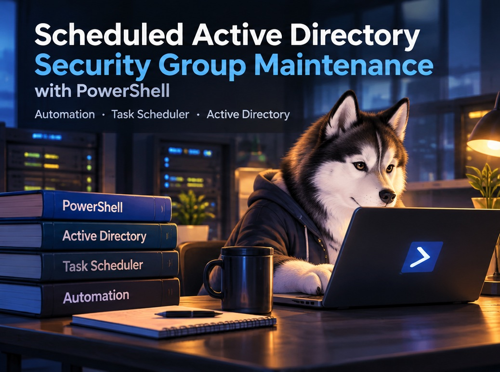
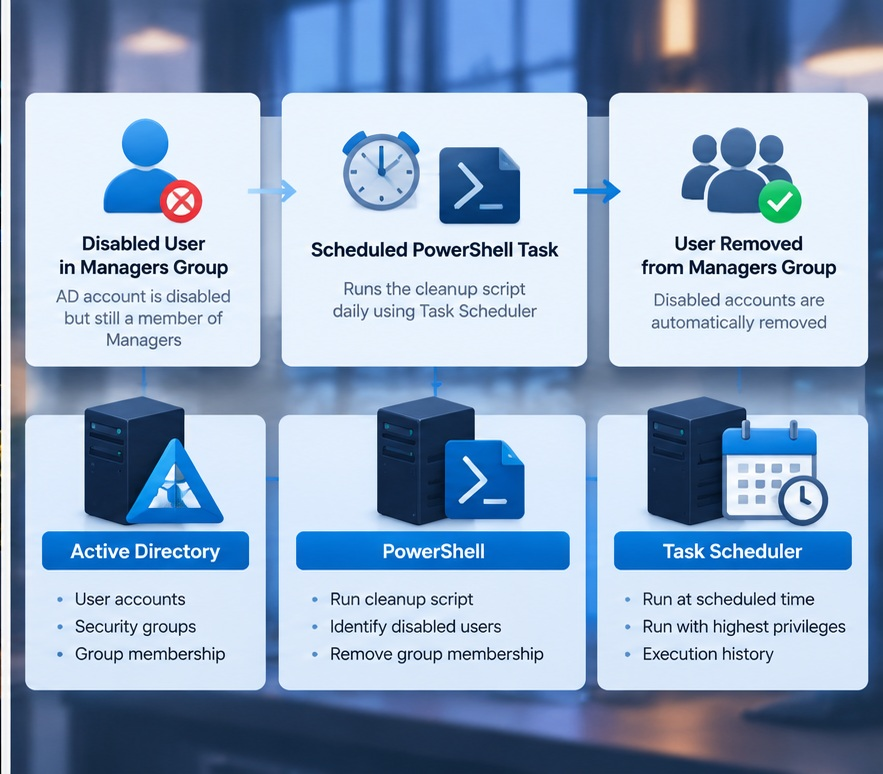
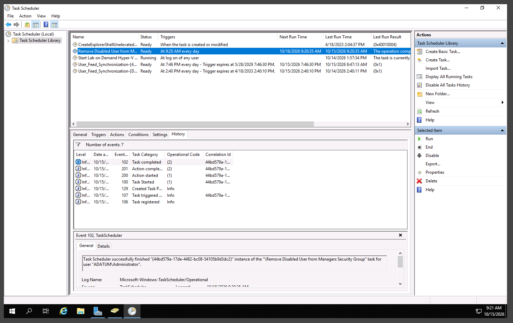
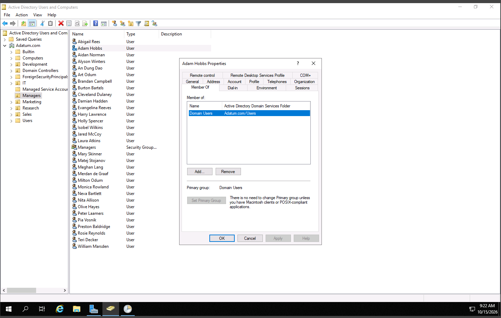

# Scheduled Active Directory Security Group Maintenance with PowerShell

**Automating security group cleanup through Windows Task Scheduler**  
Microsoft Software & Systems Academy (MSSA) — Automating Administration with Windows PowerShell (AZ-040)



## Project Overview

In this lab, I configured a scheduled PowerShell task to remove disabled user accounts from an Active Directory security group. The work combined **Task Scheduler**, **Windows PowerShell**, and **Active Directory Users and Computers (ADUC)**, with checks for both task execution and the resulting group membership.

### Business Scenario

An organization may disable an employee's account when access is no longer needed, while leaving that account in departmental security groups. The account cannot sign in normally, but obsolete memberships can complicate access reviews and may become relevant if the account is later reactivated.

The IT requirement was to regularly identify disabled users in the **Managers** group and remove their unnecessary membership without having an administrator repeat the cleanup manually.

**Scope:** I configured and tested a scheduled task that ran a **provided lab script**. I did not write or modify the script, and its internal logic was not independently reviewed. The retained evidence demonstrates one successful test account, not enterprise-wide remediation.

## Lab Environment

| Component | Configuration |
|---|---|
| Domain | `Adatum.com` |
| Server | `LON-DC1` (domain controller) |
| Test account | Adam Hobbs |
| Target security group | `Managers` |
| Automation | Windows PowerShell 5.1 and Task Scheduler |
| Script | `DeleteDisabledUserManagersGroup.ps1` |



*The diagram explains the intended process. The screenshots below are the actual execution and Active Directory verification evidence.*

## 1. Prepare the Test Account

Using ADUC on `LON-DC1`, I located **Adam Hobbs** in the Managers organizational unit and disabled the account to simulate an employee who no longer required access.

Before the scheduled task ran, I checked that the account still belonged to the **Managers** security group. This established a specific condition to test: the account should remain disabled while its Managers membership is removed.

The distinction matters because **disabling an account and cleaning up group memberships are separate administrative actions**.

## 2. Configure the Scheduled PowerShell Task

I created a Task Scheduler task named:

**`Remove Disabled User from Managers Security Group`**

| Setting | Configuration |
|---|---|
| Trigger | Daily; first test scheduled about five minutes ahead |
| User session | Run whether the user is logged on or not |
| Privileges | Run with highest privileges |
| Program | `PowerShell.exe` |
| Concurrent execution | Stop an existing task instance |

The task used the following PowerShell execution arguments:

```powershell
-ExecutionPolicy Bypass E:\Labfiles\Mod11\DeleteDisabledUserManagersGroup.ps1
```

The path pointed to the existing cleanup script supplied for the lab. Task Scheduler provided a way to run it on a schedule without keeping an interactive PowerShell window open.

**Why this approach:** The directory holds the accounts and groups, PowerShell performs the cleanup, and Task Scheduler controls when the operation runs. Separating those responsibilities made it possible to check the task's execution independently from its effect on Active Directory.

**Security consideration:** The exercise used elevated privileges and `-ExecutionPolicy Bypass`. That bypass applied to the launched PowerShell process and was a lab configuration, **not** a recommended production security baseline.

## 3. Verify Task Execution

After the first scheduled run, I opened **Task Scheduler Library → History** and reviewed the recorded events for the task.



The history showed **Event ID 102 — Task completed**, along with action start/completion events. Task Scheduler reported that the cleanup task had finished successfully.

**Verified result:** The scheduled task executed and completed during the test. A successful scheduler event alone, however, does not prove that the intended Active Directory change occurred.

## 4. Verify the Active Directory Change

I returned to ADUC and opened **Adam Hobbs → Properties → Member Of**.



The account's memberships showed **Domain Users**, but **Managers** was no longer listed.

**Verified result:** The disabled test account was removed from the Managers security group after the scheduled task ran. Checking ADUC was the important second step: it confirmed an actual directory change rather than relying only on Task Scheduler's completion status.

---

## Results and Operational Value

| Check | Observed outcome |
|---|---|
| Task schedule | Daily task configured and initial run completed |
| Task history | Event ID 102 confirmed task completion |
| Group membership | `Managers` no longer appeared for Adam Hobbs |
| Remaining membership | `Domain Users` remained listed |

This exercise demonstrated a practical way to reduce repetitive Active Directory cleanup and improve the consistency of security group membership maintenance. Task history also provided an execution record, while ADUC confirmed the actual result.

The project did not measure time savings or test the process across multiple disabled accounts.

## Lessons and Production Considerations

The biggest lesson was to **verify both the automation and the outcome**. A script can finish without producing the desired change, so a directory check is just as important as a successful scheduled-task event.

This was also different from an interactive PowerShell background job: Task Scheduler could start the script according to its configured trigger, even without an open user session.

Before using a similar process in production, I would review the script's logic, limit the scheduled task's permissions, add logging and error handling, and validate behavior across multiple account states. Script signing and safer execution-policy practices would also deserve attention.

**Skills demonstrated:** Windows PowerShell · Task Scheduler · Active Directory Administration · Security Group Maintenance · Scheduled Automation · Task History Verification · Access Governance